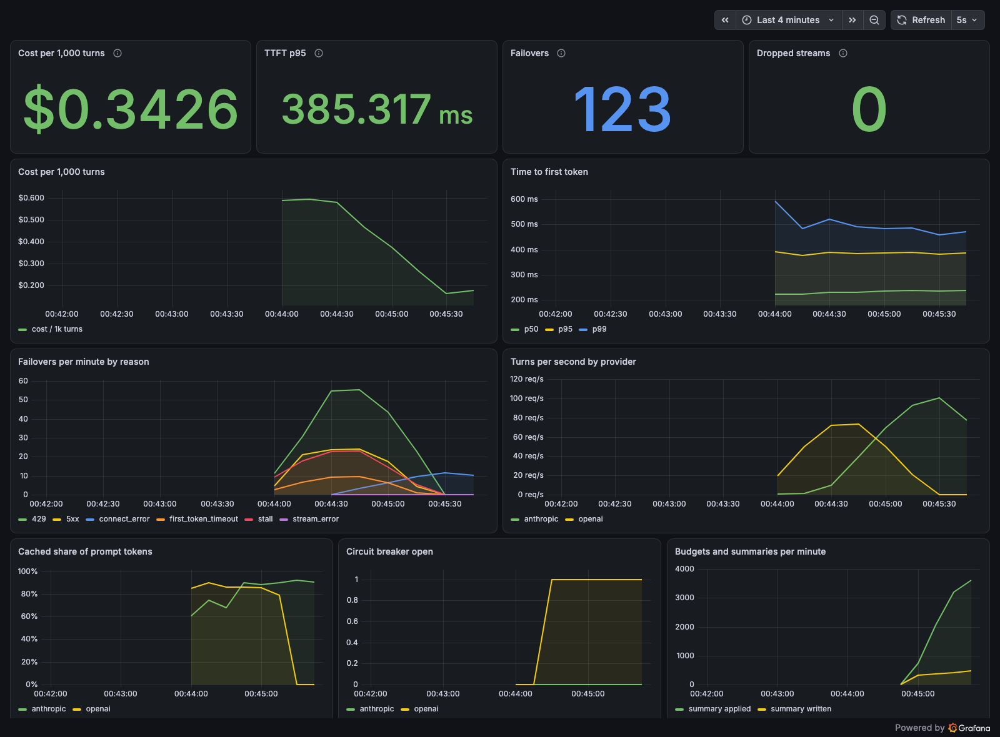

**On a replay of 1,000 concurrent character-chat sessions (31,826 turns), cost per 1,000 turns fell from $0.715 to $0.347 (−51%) and p95 time to first token from 1,074 ms to 370 ms (−66%), and when the primary provider was killed mid-run with 513 streams in flight, zero streams dropped (baseline: 480 of 558 in flight).**

# persona-chat-proxy

[](https://github.com/ThatDeparted2061/twofourlabs-persona-chat-proxy/actions/workflows/ci.yml)

An OpenAI-compatible streaming proxy for consumer character-chat apps, built with Two Four Labs' Kavana and Mira in mind. In these apps every message is a paid LLM call, so two numbers set the margins: cost per conversation and time to first token. This proxy works on both, and it keeps streams alive when a provider fails.

It is a fork of my [LLM-Gateway](https://github.com/ThatDeparted2061/LLM-Gateway), tuned for character chat:

| | What it does |
|---|---|
| **Streaming** | SSE passthrough to **OpenAI** and **Anthropic** (plus Groq, Gemini and Ollama from the parent project), in OpenAI's chunk format either way. |
| **Persona prompt caching** | Character cards are stored once (`PUT /v1/personas/{id}`) and rendered byte-identically as the request prefix. OpenAI requests carry `prompt_cache_key` (the conversation), so they stay on a cache-warm shard. Anthropic requests carry `cache_control` breakpoints after the persona, after the summary, and on the newest message. |
| **Rolling summary** | Once a conversation's unsummarized history passes 3,000 tokens, older turns are condensed into a summary in the background, never on the hot path. The summary is keyed to a hash of the messages it replaces, so an edited transcript falls back to full history. |
| **Daily budgets** | Per-user token budgets in Redis. Past the soft limit, replies are capped (and optionally sent to a cheaper model). Past the hard limit, the request gets `429 budget_exceeded`. |
| **Invisible failover** | 429, 5xx, connection errors, a slow first token (2 s) and a stalled stream (1.5 s of silence) all switch providers. A stream that dies midway is resumed on the next provider from the last byte the client got, so the user sees one uninterrupted reply. A circuit breaker skips a dead provider. |
| **Dashboard** | Prometheus metrics and a provisioned Grafana dashboard: cost per 1,000 turns, TTFT p50/p95/p99, failovers by reason, cached-token share, breaker state. |

## Results

`make demo` replays the same workload twice against simulated OpenAI and Anthropic endpoints, once through the **baseline** (the proxy in `PROXY_MODE=baseline`, which streams exactly the way LLM-Gateway did) and once **tuned**. Each run is 1,000 concurrent sessions of 16-48 turns over 8 personas (character cards of 1.5k-3.3k tokens, Zipf popularity). The primary provider is killed 45 s in. On top of that, the primary injects 1% 429s, 0.5% 5xx, 0.3% first-byte stalls and 0.5% mid-stream stalls for the whole run.

| | baseline | tuned | change |
|---|---:|---:|---:|
| Cost per 1,000 turns (USD) | $0.7147 | $0.3473 | -51.4% |
| TTFT p50 (ms) | 529 | 233 | -56.0% |
| TTFT p95 (ms) | 1074 | 370 | -65.6% |
| TTFT p99 (ms) | 1481 | 465 | -68.6% |
| Dropped streams | 480 | 0 | -100.0% |
| Corrupt replies | 0 | 0 | = |
| Turns | 31826 | 31826 | +0.0% |
| Budget-blocked or rate-limited turns | 0 | 0 | = |
| Concurrent sessions | 1000 | 1000 | +0.0% |
| Streams in flight at kill | 558 | 513 | -8.1% |
| Cached share of prompt tokens | 18.9% | 91.1% | +380.5% |
| Prompt tokens per turn | 5073 | 4275 | -15.7% |
| Summaries applied to prompts | 0 | 12180 | new |
| Provider failovers | 19582 | 838 | -95.7% |

Every reply carries a checksum, and the load generator verifies it, so "0 dropped, 0 corrupt" means every reply arrived complete with nothing missing or repeated, including those resumed on another provider.

Where the gains come from:

- **Cost.** In the baseline, OpenAI requests carry no `prompt_cache_key`. Hundreds of sessions share each persona's first 256 tokens, so they all hash to one routing slot, overflow past ~15 requests/min, and land on machines without their conversation cached. Only the persona prefix gets reused. Anthropic caches nothing without `cache_control`. Tuned, almost the whole prompt is a cache read, and the rolling summary keeps long conversations from growing without bound.
- **TTFT.** Prefill time scales with uncached prompt tokens, so the cache gains show up as latency too. Failover adds no tail latency: once the breaker trips, the dead provider costs one fast failure per 5 s instead of a connection attempt per request.
- **Dropped streams.** The baseline fails over only before the first byte, so every stream in flight at the kill is lost, and a stalled stream hangs until the client gives up. The tuned relay resumes all of them.

### Dashboard

A live 400-session run with the primary killed partway through. You can see OpenAI traffic drop to zero as Anthropic takes over, OpenAI's breaker open, failovers by reason, and cost per 1,000 turns falling as the rolling summaries kick in, with zero dropped streams throughout.



### How the providers are simulated

Paying for a 30,000-turn benchmark on every change is not practical, so `cmd/fakellm` stands in for the providers. It speaks the real wire formats: OpenAI chat completions, and Anthropic Messages with its typed SSE events. The same adapters run against it as against the real APIs. Each provider's documented caching rules are modelled:

- **OpenAI** ([docs](https://platform.openai.com/docs/guides/prompt-caching)): automatic caching for prompts of 1,024+ tokens, in 128-token steps. Requests are routed by a hash of the first ~256 tokens plus `prompt_cache_key`, overflow past ~15 requests/min per prefix+key, and entries expire after 5 minutes idle.
- **Anthropic** ([docs](https://docs.anthropic.com/en/docs/build-with-claude/prompt-caching)): caching happens only at `cache_control` breakpoints, with a 20-block lookback, a 512-token minimum (Claude Haiku 5.5) and a 5-minute TTL. Writes bill at 1.25x and reads at 0.1x.
- **Latency:** TTFT = 180 ms + 80 µs per uncached prompt token + 8 µs per cached token, with lognormal jitter. Decode runs at 120 tokens/s.
- **Time:** the gaps between turns are compressed 20x (0.5-2.5 s stands in for 10-50 s of a person typing), and cache TTLs and rate windows are compressed by the same factor.
- **Prices:** list prices for `gpt-4.1-mini` and `claude-haiku-5-5` (`internal/pricing`, overridable in config).

All of these are flags on `fakellm`. To check against real traffic, point `OPENAI_BASE_URL` and `ANTHROPIC_BASE_URL` at the real APIs: the proxy reads cache hits from the providers' own usage fields (`cached_tokens`, `cache_read_input_tokens`, `cache_creation_input_tokens`) and prices them the same way.

## Run it

```bash
make demo          # Go + a local Redis: baseline vs tuned, writes bench/RESULTS.md (~8 min)
make demo-quick    # 200 sessions
make up            # docker compose: proxy, Redis, simulated providers, load generator, Prometheus, Grafana
make test          # go vet + go test -race (Redis-backed tests skip without Redis)
```

With `make up`, open Grafana at http://localhost:3000. The *persona-chat-proxy* dashboard is the home page. `PROXY_MODE=baseline make up` runs the baseline.

## Using it

```bash
# store a character once
curl -X PUT localhost:8080/v1/personas/mira -d '{"name":"Mira","prompt":"You are Mira, a warm late-night confidant..."}'

# chat: any OpenAI client works; persona_id replaces the system prompt
curl -N localhost:8080/v1/chat/completions \
  -H 'X-User-ID: user-42' -H 'X-Conversation-ID: conv-9' \
  -d '{"persona_id":"mira","stream":true,"messages":[{"role":"user","content":"hey, you up?"}]}'
```

The stream ends with a usage chunk that reports what the turn cost (captured from a live run against the simulator):

```json
{"choices":[],"model":"gpt-4.1-mini","object":"chat.completion.chunk",
 "usage":{"prompt_tokens":1480,"completion_tokens":195,"total_tokens":1675,"prompt_tokens_details":{"cached_tokens":1408}},
 "x_proxy":{"provider":"openai","cost_usd":0.0004816,"failovers":[],"summary_applied":false,"budget_state":"ok","ttft_ms":307}}
```

| Header | Meaning |
|---|---|
| `X-User-ID` | Budget and rate-limit identity (defaults to the API key). |
| `X-Conversation-ID` | Turns on rolling summaries and OpenAI cache routing for the conversation. |
| `X-Budget-State` (response) | `ok`, `soft` or `hard`. |

## How the relay works

```
client ──► budget ──► persona + summary + recent turns ──► relay ──► provider A ──┐
                                                             │      (stream)     │ stall / error / EOF
                                                             │◄──────────────────┘
                                                             └──► provider B: "continue from <<<last bytes sent>>>"
client ◄── one SSE stream: tokens from A, then from B, then a usage chunk with the cost of both attempts
```

1. **Before the first token**, any error or a 2 s wait moves to the next provider. 429s and 5xx are not billed. A connection that never answered is billed as if the provider ran prefill.
2. **After the first token**, the relay resets a 1.5 s stall timer on every chunk. On a stall, an error or an early EOF, it cancels that stream and sends the next provider the same prompt plus a trailing system message that holds the partial reply and asks it to continue. The message goes after everything cached, so the cached prefix is untouched. Assistant prefill would be the natural tool, but current Claude models reject it.
3. **A breaker per provider** opens after 3 consecutive failures and skips that provider for 5 s.
4. **Cost accounting** prices every attempt, including the ones that failed, from the provider's own usage numbers. It falls back to an estimate only when a dead stream never reported usage.

## Layout

| Path | |
|---|---|
| `cmd/proxy` | The proxy |
| `cmd/fakellm` | Simulated OpenAI and Anthropic upstream: caching models, latency model, fault injection, `/admin/kill` |
| `cmd/loadgen` | Session replayer, checksum verification, mid-run kill, markdown comparison |
| `internal/router` | `relay.go`: resumable failover, timers, breaker. `router.go`: the parent project's pre-first-byte failover (the baseline) |
| `internal/providers` | OpenAI, Anthropic, Groq, Gemini, Ollama adapters |
| `internal/handlers` | Request assembly (persona, summary, cache marks), streaming, cost and budget accounting |
| `internal/history` | Rolling summaries |
| `internal/budget`, `internal/persona`, `internal/pricing` | Budgets, persona store, price table |
| `deploy/grafana` | Provisioned dashboard |

## Limits and next steps

- Token counts for budgets and summary thresholds use a 4-bytes-per-token estimate. Billing uses the providers' reported usage.
- The continuation instruction depends on the model following it. With real models a resumed reply can repeat a few words at the seam, and trimming overlap at the seam would fix that.
- Budgets are check-then-spend, so concurrent turns from one user can overshoot the hard limit by the turns in flight.
- The next step is a 1% shadow run against real OpenAI and Anthropic keys, to calibrate the simulator's cache hit rates against production.
